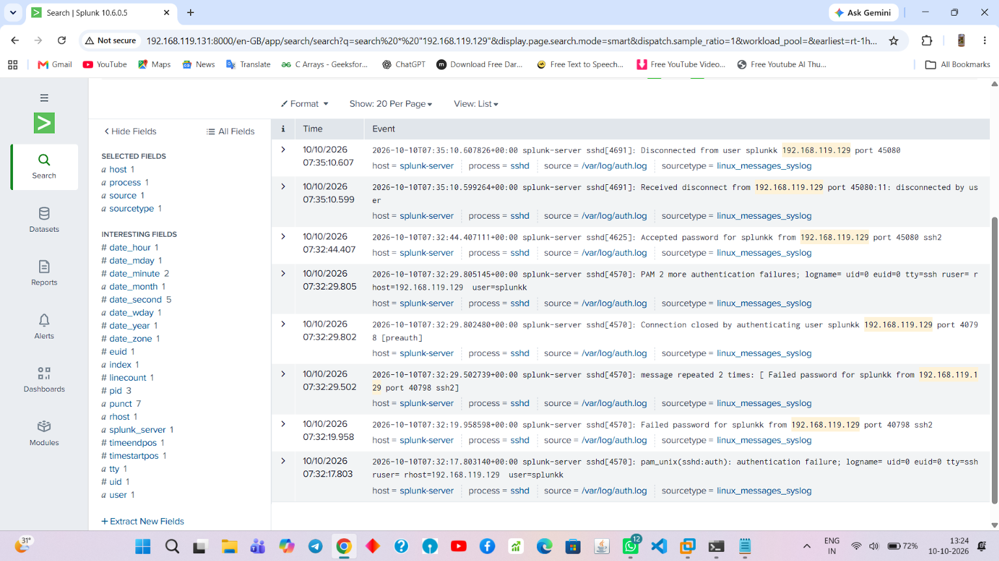
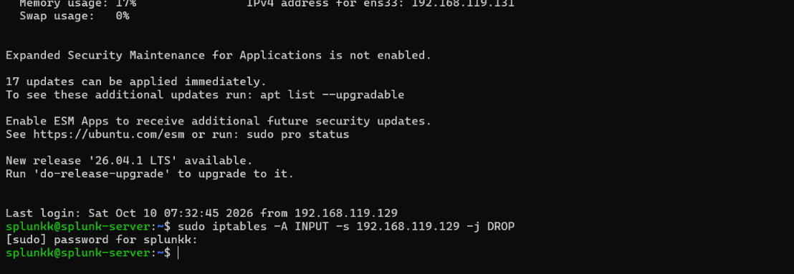
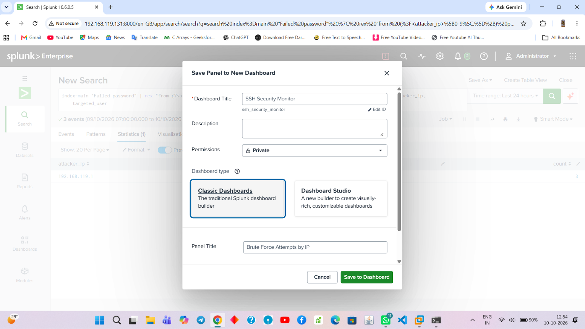

# splunk-incident-response
Learning to write reports .
# Enterprise Incident Triage: SSH Brute-Force & Host Compromise Analysis

## 1. Incident Response Overview
* **Incident Verdict:** True Positive (Critical Risk Escalation)
* **Threat Classification:** SSH Brute-Force Attack resulting in Host Compromise
* **Analysis Timeframe:** 2026-10-10 07:32:17 UTC to 2026-10-10 07:35:10 UTC
* **Target Endpoint Architecture:** `splunk-server` (Ubuntu Linux Node)
* **Compromised Identity:** `splunkk` (Local User Account)
* **Malicious Source Identifier:** `192.168.119.129`

---

## 2. Technical Executive Summary
During routine log monitoring within the central SIEM platform, a Security Operations Center (SOC) Level 1 analyst detected a severe authentication anomaly targeting the local network infrastructure. An untrusted host at IP address `192.168.119.129` executed a rapid, automated password-guessing campaign over port 22 (SSH) directed at the local system user `splunkk`. 

The security perimeter was breached at `07:32:44 UTC` when the threat actor successfully guessed the credentials, obtaining an interactive shell on the server. Due to the critical nature of an active server compromise and the high probability of downstream lateral movement or localized data exfiltration, the incident was verified as a True Positive, marked for emergency containment, and escalated to the Level 2 engineering team.

---

## 3. SIEM Log Analysis & Timeline
The visual evidence below details the lifecycle of the attack, captured directly from the Linux `syslog` pipeline indexed by the SIEM engine:



### Incident Event Sequencing
* **07:32:17 UTC | Inbound Probing:** The attacker initiated an explicit authentication attempt, generating the initial system log warning:  
  `Failed password for splunkk from 192.168.119.129 port 40798 ssh2`
* **07:32:19 UTC | Brute-Force Volatility:** The system log recorded a rapid succession of credential failures (`message repeated 2 times`), establishing a definitive dictionary or brute-force pattern.
* **07:32:44 UTC | Host Breach:** The operational status escalated from a brute-force *attempt* to a *successful compromise* as indicated by the key security metric:  
  `Accepted password for splunkk from 192.168.119.129 port 45080 ssh2`
* **07:35:10 UTC | Session Tear-Down:** The attacker concluded the first interactive session, disconnecting from the server after an exposure duration of **2 minutes and 26 seconds**.

---

## 4. Triage & Incident Metrics
* **Attacker Lifecycle Phase:** Initial Access / Credential Access (MITRE ATT&CK T1110 - Brute Force).
* **Exposure Window:** The malicious actor possessed unchecked administrative shell access to the host for exactly 146 seconds before terminating the TCP connection.
* **Post-Exploitation Risk:** High risk of internal credential harvesting, persistence creation via SSH authorized keys, or the download of secondary payload stages.

---

## 5. Active Defensive Remediation & Containment

### Immediate Tactical Mitigation
To simulate proactive incident containment on the live endpoint, the `iptables` kernel firewall utility was used to immediately enforce a packet-filtering rule. The source address `192.168.119.129` has been systematically configured to `DROP` all incoming connection packets, cutting off further network interaction.

The terminal output below documents the manual execution of the rule injection:



```bash
# Injection command utilized to enforce immediate source IP containment:
sudo iptables -A INPUT -s 192.168.119.129 -j DROP
```

### Proactive Detection Engineering
To transform this reactive analysis into persistent operational protection, a customized monitoring rule was built from the source query. The detection logic has been transformed into a persistent monitoring asset within a new dedicated security dashboard named `SSH Security Monitor`, ensuring immediate visualization of similar brute-force spikes.

The panel configuration setup is documented below:



---

## 6. Long-Term Architectural Recommendations
1. **Network Layer Hardening:** Implement explicit perimeter firewall rules to block direct SSH exposure to untrusted external subnets. Force all administrative SSH access through an isolated VPN or Bastion host architecture.
2. **Identity & Access Management (IAM):** Enforce strict strong-password complexity requirements across local accounts to mitigate basic dictionary guessing attacks. Implement Multi-Factor Authentication (MFA) for all system-level shell entry points.
3. **Automated Defensive Orchestration:** Deploy an automated Host Intrusion Prevention system such as `Fail2ban` to parse `/var/log/auth.log` dynamically, automatically invoking ephemeral kernel drops via `iptables` after 5 sequential failure flags are triggered.
